# Database ERD

## Version And Source

Version: 1.1 (2026-11-09)

Status: Aligned with the current EF Core model and migration snapshot. The live
Supabase database has not been introspected for this update. Compare its applied
migrations before claiming that the deployed schema is identical.

Source: `backend/RodeoBarberShop.Api/Data/ApplicationDbContext.cs` and
`backend/RodeoBarberShop.Api/Migrations/ApplicationDbContextModelSnapshot.cs`.
The model defines 23 mapped tables and 33 foreign-key relationships. This ERD
describes the physical data model, not completion of every planned UI workflow.

## Reading The Diagram

- `PK` is a primary key; `FK` points to a primary key in another table.
- `||--o{` means one parent can have zero or many child rows. `||--o|` means
  one parent can have zero or one child row.
- `o|` at the parent end marks a nullable FK: a child row may have no related
  parent row in that role. Optional relationships are also listed below.
- Column names are case-sensitive in PostgreSQL. Most PK columns are `Id`, not
  `id`; `barber_booking_closures` also retains PascalCase column names because
  its properties were not explicitly mapped to snake_case.
- Each entity shows its key columns and representative business fields, not
  every column. Consult the model snapshot for the complete column inventory.

## Mermaid ERD

```mermaid
erDiagram
    users {
        uuid Id PK
        varchar full_name
        varchar nickname
        varchar phone_number
        varchar email
        text password_hash
        varchar role
        varchar account_status
        timestamptz created_at
    }

    customer_profiles {
        uuid Id PK
        uuid user_id FK
        timestamptz created_at
    }

    barber_profiles {
        uuid Id PK
        uuid user_id FK
        text specialty
        int experience_years
        int standby_priority
        boolean is_available
        boolean accepts_booking
    }

    services {
        uuid Id PK
        varchar name
        numeric price
        int duration_minutes
        boolean is_active
    }

    barber_services {
        uuid Id PK
        uuid barber_id FK
        uuid service_id FK
    }

    barber_working_hours {
        uuid Id PK
        uuid barber_id FK
        int day_of_week
        time start_time
        time end_time
        boolean is_working_day
    }

    chairs {
        uuid Id PK
        varchar name
        int sort_order
        boolean is_active
    }

    barber_chair_assignments {
        uuid Id PK
        uuid chair_id FK
        uuid barber_id FK
        date start_date
        date end_date
        boolean is_primary
    }

    leave_requests {
        uuid Id PK
        uuid barber_id FK
        varchar leave_type
        timestamptz start_at
        timestamptz end_at
        varchar status
        uuid reviewed_by_user_id FK
    }

    leave_events {
        uuid Id PK
        uuid leave_request_id FK
        uuid actor_user_id FK
        varchar action
        timestamptz created_at
    }

    barber_booking_closures {
        uuid Id PK
        uuid BarberId FK
        timestamptz StartAt
        timestamptz EndAt
        varchar Reason
        uuid ClosedByUserId FK
        uuid ReopenedByUserId FK
        timestamptz ReopenedAt
    }

    bookings {
        uuid Id PK
        varchar booking_number
        varchar booking_source
        uuid customer_id FK
        varchar guest_name
        varchar guest_phone_number
        varchar guest_email
        uuid barber_id FK
        uuid created_by_user_id FK
        timestamptz start_at
        timestamptz end_at
        varchar booking_status
        varchar payment_status
        numeric total_amount
    }

    booking_services {
        uuid Id PK
        uuid booking_id FK
        uuid service_id FK
        varchar service_name
        numeric unit_price
        int duration_minutes
        int quantity
        numeric line_total
        boolean added_during_service
        uuid added_by_user_id FK
    }

    queue_events {
        uuid Id PK
        uuid booking_id FK
        varchar from_status
        varchar to_status
        uuid changed_by_user_id FK
        timestamptz created_at
    }

    barber_assignment_events {
        uuid Id PK
        uuid booking_id FK
        uuid from_barber_id FK
        uuid to_barber_id FK
        uuid changed_by_user_id FK
        timestamptz created_at
    }

    payment_accounts {
        uuid Id PK
        varchar account_name
        varchar account_type
        varchar account_number
        varchar bank_name
        boolean is_active
        boolean is_default
    }

    payments {
        uuid Id PK
        uuid booking_id FK
        uuid payment_account_id FK
        varchar payment_number
        varchar payment_method
        varchar payment_status
        numeric subtotal_amount
        numeric discount_amount
        numeric total_amount
        timestamptz paid_at
        uuid received_by_user_id FK
    }

    shop_settings {
        uuid Id PK
        varchar shop_name
        text address
        varchar phone_number
        time opening_time
        time closing_time
        int booking_advance_days
        int cancellation_deadline_hours
        int slot_interval_minutes
    }

    shop_holidays {
        uuid Id PK
        varchar holiday_type
        int day_of_week
        date holiday_date
        text reason
    }

    promotions {
        uuid Id PK
        varchar name
        date start_date
        date end_date
        varchar discount_type
        numeric discount_value
        boolean is_active
    }

    promotion_services {
        uuid Id PK
        uuid promotion_id FK
        uuid service_id FK
    }

    notifications {
        uuid Id PK
        uuid recipient_user_id FK
        varchar recipient_role
        uuid related_booking_id FK
        varchar title
        varchar notification_type
        boolean is_read
    }

    email_otps {
        uuid Id PK
        varchar email
        text otp_hash
        varchar purpose
        timestamptz expires_at
        timestamptz verified_at
    }

    users ||--o| customer_profiles : has_customer_profile
    users ||--o| barber_profiles : has_barber_profile
    users o|--o{ bookings : customer
    users o|--o{ bookings : created_by
    barber_profiles o|--o{ bookings : assigned_barber

    bookings ||--o{ booking_services : contains
    services ||--o{ booking_services : selected_as
    users o|--o{ booking_services : added_by
    bookings ||--o{ queue_events : status_history
    users o|--o{ queue_events : changed_by
    bookings ||--o{ barber_assignment_events : assignment_history
    barber_profiles o|--o{ barber_assignment_events : from_barber
    barber_profiles o|--o{ barber_assignment_events : to_barber
    users ||--o{ barber_assignment_events : changed_by

    barber_profiles ||--o{ barber_services : can_perform
    services ||--o{ barber_services : performed_by
    barber_profiles ||--o{ barber_working_hours : works
    barber_profiles ||--o{ barber_chair_assignments : assigned_to
    chairs ||--o{ barber_chair_assignments : used_by
    barber_profiles ||--o{ leave_requests : requests
    users o|--o{ leave_requests : reviewed_by
    leave_requests ||--o{ leave_events : has_history
    users ||--o{ leave_events : acted_by
    barber_profiles ||--o{ barber_booking_closures : unavailable_periods
    users ||--o{ barber_booking_closures : closed_by
    users o|--o{ barber_booking_closures : reopened_by

    bookings ||--o{ payments : payment_history
    payment_accounts o|--o{ payments : received_into
    users ||--o{ payments : received_by
    promotions ||--o{ promotion_services : includes
    services ||--o{ promotion_services : included_in
    users o|--o{ notifications : recipient
    bookings o|--o{ notifications : related_booking
```

## Important Constraints And Behavior

- `bookings.customer_id` references `users.Id` directly, not
  `customer_profiles.Id`. It can be null when guest contact fields are stored
  on the booking. `bookings.barber_id` is also nullable in the database, but
  the current customer booking flow still requires choosing a barber.
- `booking_services` is the many-to-many bridge between bookings and services.
  It stores the service name, price, duration and total as booking-time
  snapshots; later edits to `services` do not rewrite existing line items.
- `barber_services` is the many-to-many bridge between barbers and services.
  `barber_chair_assignments` connects barbers to chairs for a date range;
  `is_primary` distinguishes primary from standby assignments.
- `leave_requests` records the leave period and review status; `leave_events`
  records actions taken on a request. `barber_booking_closures` records a
  separate staff-controlled closure and optional reopening. These tables do
  not automatically move existing bookings to another barber.
- A booking can have multiple `payments` rows as history, including voided
  corrections. A filtered unique index permits **at most one** row with
  `payment_status = 'Paid'` per booking. Cash payments need no
  `payment_account_id`; bank transfer and QR payments use an account. A receipt
  is derived from booking/payment data; there is no separate `receipts` table.
- `shop_settings`, `shop_holidays` and `email_otps` have no FK connecting them
  to other tables. Shop opening hours and holidays are combined with barber
  schedules, leave, closures and chairs in booking-availability logic, not by
  a direct database relationship.
- The presence of `promotions`, `notifications` and `email_otps` tables does
  not mean their complete customer-facing workflows are implemented.

## Live Database Verification

This file was checked against the current code model and migration snapshot,
not a live Supabase schema dump. Before using it as proof of the deployed DB,
compare the Supabase `__EFMigrationsHistory` entries and actual tables, columns,
foreign keys and indexes with the repository migrations. In particular, check
the case-sensitive `Id` and `barber_booking_closures` column names.
